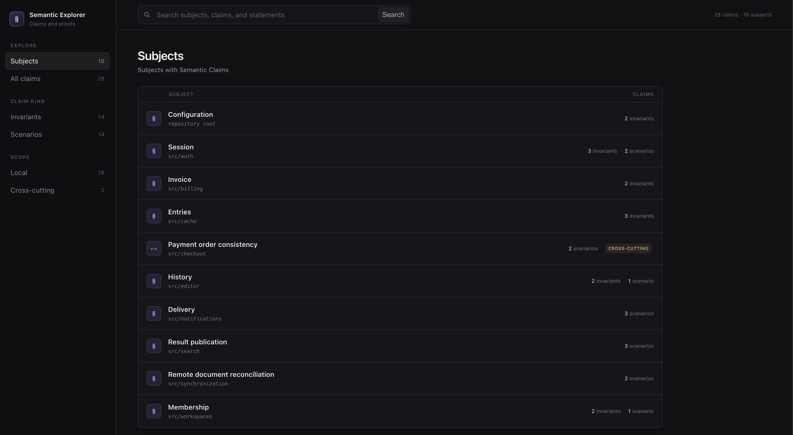

# Semantic Claims Model

Semantic Claims is a way to keep software semantics understandable and testable as code changes.

It's designed to help people, coding agents, and sentient creatures build and maintain software over time.

From [REFERENCE.md](./REFERENCE.md):

> Semantic Claims provides a way to specify, prove, and preserve the **public semantics** of any given system.

- [Definitions and Terminology](./REFERENCE.md#definitions)
- [Purpose](./REFERENCE.md#purpose)

## Links

2. [FAQ.md](./FAQ.md): common questions about Semantic Claims, TDD, and acceptance criteria
3. [REFERENCE.md](./REFERENCE.md): the detailed rules for claims, proofs, document structure, and the authoring workflow
4. [EXAMPLES.md](./EXAMPLES.md): claim-decision examples and borderline cases
5. [AMBIGUITY.md](./AMBIGUITY.md): words and constructs that make a claim ambiguous, with clearer forms
6. [JAVASCRIPT.md](./JAVASCRIPT.md): the JavaScript and TypeScript conventions

## Introduction

Semantic Claims is very similar to TDD (one could call it STDD, though not my _favorite_ acronym). The difference is that the tests are considered proofs, and are driven by **Semantic Claims**.

Semantic Claims involves recording the semantics of a system as prose, codifying them as test proofs, and using those claims and proofs to protect from unintentional drift over time. Changes to semantics become obvious in PRs, encourage thoughtful design, refactors, and testing, and are _much_ easier to spot than subtle changes to tests. Updating a semantic claim forces an edit to a plain-language description of how the system works today, followed by updating an accompanying proof. In other words, it requires _real intention_.

Semantic Claims also provides valuable context between authors on how parts of a system are intended to work, how these parts work with each other, and how they have changed over time, which is useful when trying to understand how a system organically grows.

Working with Semantic Claims is designed to be a practical workflow:

```text
claim  ->  prove  ->  implement
          └────────────────────┘
             Just like TDD 🎉
```

Breaking down the steps:

1. **claim**: specify semantics in a well-formed Markdown file
2. **prove**: write tests that prove those semantics
3. **implement**: write (or update) the implementation until proofs pass

This produces three colocated artifacts. For example, in a TS codebase:

```text
src/
├── account-service.scenarios.md        <- the system's Semantic Claims
├── account-service.scenarios.test.ts   <- the system's semantic proofs
└── account-service.ts                  <- the system itself
```

## In practice

### Claim documents

Claim documents are well-formed Markdown files that enumerate a system's semantics. From our prior example:

```text
src/
├── account-service.scenarios.md        <- the system's Semantic Claims
├── account-service.scenarios.test.ts   <- the system's semantic proofs
└── account-service.ts                  <- the system itself
```

The claim document might look like this:

```md
# Account service

An email address is *registered* if an account uses the email address.

## §1 Password reset

### §1.1 A reset request sends a reset link

WHEN a password reset is requested for a registered email address, the account service SHALL send a reset link to the email address.
```

This is a well-formed, albeit incomplete, claim document:

1. `Account service` is the **system** of the claims
2. The introduction defines `registered`
3. `Password reset` is a **section**, grouping one or more claims together
4. `A reset request sends a reset link` is a single **claim**
5. `WHEN a password reset is requested for a registered email address, the account service SHALL send a reset link to the email address.` is the claim's statement, written in an [EARS](./REFERENCE.md#claim-kinds) sentence pattern

Well-written and exhaustive Semantic Claims and proofs provide confidence that, as long as the proof continues passing and still makes sense within the context of the semantic claim, no semantics of the system have changed. That is to say that no public characteristics (whether it be observable behavior, state, or events) of the account service have changed.

### Proofs

Every claim document has a paired **proof** file containing proofs-as-tests of its claimed behaviors. In this JS/TS example, the paired proof would be named `src/account-service.scenarios.test.ts`, and its tests would repeat the section and claim titles _exactly_:

```ts
describe('§1 Password reset', () => {
  it('§1.1 A reset request sends a reset link', async () => {
    const sent: unknown[] = [];
    const service = createAccountService({
      accounts: ['ada@example.com'],
      send: (message) => sent.push(message),
    });

    await service.requestPasswordReset('ada@example.com');

    expect(sent).toContainEqual({ to: 'ada@example.com', resetLink: expect.any(String) });
  });
});
```

The colocation and exacting structure allow tools like the checker (provided in this package) to verify links between well-structured claims and proofs—as well as catch issues like missing proofs or mismatches.

### Claim kinds

There are only two kinds of claims: [**invariants**](./REFERENCE.md#claim-kinds) and [**scenarios**](./REFERENCE.md#claim-kinds). There are also [**cross-cutting claims**](./REFERENCE.md#cross-cutting-claims), which is a way to define claims that do not belong to a single system.

The checker is strict in pattern-matching to make sure that claims follow the correct format, structure, and EARS syntax.

## Design and planning

Semantic Claims can be included as part of an existing design and planning process. Thinking through, drafting, and revising claims to tighten designs and work through functionality is always fine, just so long as the proofs for them are written _before_ implementation.

## Tooling

The repo also includes a [JS and TS claim checker and local Semantic Explorer](./scripts/check-semantics.mjs), plus an [agent skill](./.agents/skills) that can be used to help integrate the method into development workflows.

Fun fact! Semantic Claims were used to build the [validation scripts](./scripts), if you want to see the model in action.

You can install the checker as a dev dependency:

```sh
npm install --save-dev semantic-claims
```

It supports Node 22 and newer. I've also used it successfully in a pnpm monorepo, but ymmv.

Add commands for checking claims and opening the explorer:

```json
{
  "scripts": {
    "check:semantics": "semantic-claims",
    "explore:semantics": "semantic-claims explore"
  }
}
```

The checker verifies the links between claim documents and proof files, including their identifiers, titles, and test structure:

```sh
npm run check:semantics
```

Proofs are just normal tests and should run as part of your test harness.

The [JS and TS conventions](./JAVASCRIPT.md) define the supported filenames and the exact links between claims and proofs.

The commands `semantic-claims invariants` and `semantic-claims scenarios` are also available when only one claim kind needs checking.

### Explore claims

Start the Semantic Explorer from the project root:

```sh
npm run explore:semantics
```

The command checks the claim links, starts a read-only local server, and prints the URL. The explorer is a nice little dashboard that groups claims by subject and supports filtering by claim kind, cross-cutting status, and text. Restart it to pick up file changes.



### Install the agent skill

The Semantic Claims skill follows the open [Agent Skills specification](https://agentskills.io). From a project root, install it with the [`skills` CLI](https://skills.sh):

```sh
npx skills add hejhi/semantic-claims
```

Append a release tag, such as `hejhi/semantic-claims#v0.2.0`, to install the skill matching that checker release. Update or remove it with `npx skills update` and `npx skills remove`.

Earlier releases installed four `semantic-claims-*` skills. Delete those directories after installing this one.

A release that changes the claim format includes a migration directive in the skill's `migrations/` directory. After upgrading, ask your agent to migrate the project's claims, answer the questions it asks, and review the changed claims and proofs as one semantic change before accepting them.

### Use the agent skill

Select `semantic-claims` in your agent's skill picker, or mention Semantic Claims in a request, and describe the work:

- **Claims:** "Write claims for the account service's password reset."
- **Proofs:** "Write proofs for the claims in `src/account-service.scenarios.md`."
- **Implementation:** "Add email verification to the account service."
- **A review:** "Review this diff against its claims."

A request for claims or proofs completes only that stage. Feature work and bug fixes include the claim and proof updates they need.

### Remove it

Uninstall the checker package and remove its package scripts if present (no claims or proofs will be harmed in the process):

```sh
npm uninstall semantic-claims
```
